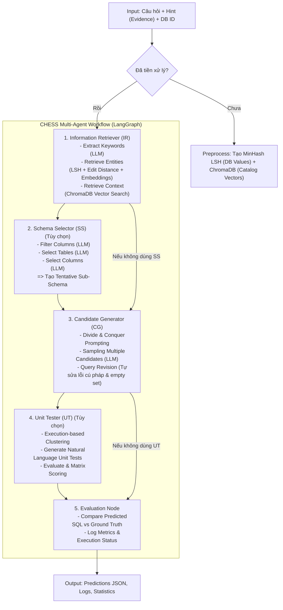

# Phân tích Chi tiết Codebase CHESS (Contextual Harnessing for Efficient SQL Synthesis)

## 1. Tổng quan Dự án (Project Overview)

**CHESS (Contextual Harnessing for Efficient SQL Synthesis)** là kho mã nguồn mở triển khai nghiên cứu cùng tên của nhóm tác giả *Shayan Talaei, Mohammadreza Pourreza, Yu-Chen Chang, Azalia Mirhoseini, Amin Saberi* (arXiv:2405.16755, 2024).

Dự án giải quyết bài toán **Text-to-SQL** (chuyển đổi câu hỏi ngôn ngữ tự nhiên thành câu truy vấn SQL) phức tạp trong môi trường cơ sở dữ liệu quy mô lớn (industrial-scale databases), được đo kiểm trên tập dữ liệu chuẩn **BIRD** (BIg Bench for Large-scale Database Grounded Text-to-SQL).

### Các thách thức lớn trong Text-to-SQL được CHESS giải quyết:
1. **Catalog & Database Values khổng lồ**: Kích thước schema và giá trị trong DB vượt quá context window hoặc làm loãng ngữ cảnh của LLM.
2. **Suy luận trên Schema phức tạp**: Số lượng bảng và cột lớn làm tăng nguy cơ hallucination (bịa đặt tên bảng/cột) hoặc chọn nhầm khóa ngoại.
3. **Đảm bảo tính hợp lệ về mặt chức năng (Functional Validity)**: Truy vấn SQL sinh ra dễ gặp lỗi cú pháp hoặc trả về tập kết quả rỗng (zero-count / empty set).
4. **Sự mơ hồ trong câu hỏi tự nhiên (Ambiguity)**: Câu hỏi người dùng ngắn gọn, thiếu ràng buộc cụ thể hoặc chứa các từ lóng/thuật ngữ nghiệp vụ.

---

## 2. Kiến trúc Hệ thống (System Architecture)

CHESS được xây dựng theo kiến trúc **Multi-Agent** phối hợp dựa trên **LangGraph** và **LangChain**, kết hợp với các kỹ thuật Information Retrieval (MinHash LSH, Vector Search) và Execution-guided Verification.

### Sơ đồ luồng xử lý tổng thể



---

## 3. Chi tiết Các Thành phần Cốt lõi (Core Components)

### 3.1. Information Retriever (IR) Agent
- **Vị trí code**: `src/workflow/agents/information_retriever/`
- **Nhiệm vụ**: Trích xuất dữ liệu, định danh thực thể và ngữ cảnh mô tả cột/bảng liên quan từ câu hỏi và gợi ý (evidence).
- **Các Tool trong Tool-Kit**:
  1. `ExtractKeywords`: Dùng LLM trích xuất danh sách các từ khóa, thực thể, giá trị tiềm năng từ câu hỏi và evidence.
  2. `RetrieveEntity`:
     - Tìm kiếm giá trị tương đồng trong DB thông qua cấu trúc **MinHash LSH** (Locality-Sensitive Hashing).
     - Lọc tinh (re-rank/filter) bằng **Edit Distance (SequenceMatcher)** với ngưỡng `edit_distance_threshold = 0.3`.
     - Tính toán độ tương đồng ngữ nghĩa bằng **Embedding Vector** (OpenAI `text-embedding-3-small` / cosine similarity) với ngưỡng `>= 0.6`.
     - Tìm kiếm tên cột gần giống trong schema.
  3. `RetrieveContext`: Truy vấn **ChromaDB** vector store chứa mô tả bảng và cột (sử dụng `text-embedding-3-large`), lấy về `top_k` mô tả khớp nhất cho từng từ khóa.

### 3.2. Schema Selector (SS) Agent
- **Vị trí code**: `src/workflow/agents/schema_selector/`
- **Nhiệm vụ**: Thu hẹp (prune) schema lớn xuống thành một sub-schema nhỏ gọn, giúp giảm đến **5x lượng token** và tăng ~2% độ chính xác.
- **Các Tool trong Tool-Kit**:
  1. `FilterColumn`: Lấy thông tin profile cột (data format, mô tả, mẫu giá trị, khóa ngoại/chính) và hỏi LLM xem cột này có liên quan đến câu hỏi hay không. Tự động liên kết lại các khóa kết nối (foreign keys / connections) để đảm bảo tính toàn vẹn khi JOIN.
  2. `SelectTables`: Yêu cầu LLM (mặc định cấu hình dùng model mạnh như GPT-4o) chọn danh sách các bảng thiết yếu và giải thích lý do (Chain-of-Thought).
  3. `SelectColumns`: Lọc tiếp các cột cần thiết trong các bảng đã được chọn.

### 3.3. Candidate Generator (CG) Agent
- **Vị trí code**: `src/workflow/agents/candidate_generator/`
- **Nhiệm vụ**: Sinh truy vấn SQL ứng viên chất lượng cao và tự động sửa lỗi truy vấn (iterative refinement).
- **Các Tool trong Tool-Kit**:
  1. `GenerateCandidate`:
     - Sử dụng phương pháp **Recursive Divide-and-Conquer**: chia nhỏ câu hỏi phức tạp thành các câu hỏi con, viết pseudo-SQL cho từng phần, sau đó kết hợp lại thành câu lệnh SQL hoàn chỉnh.
     - Hỗ trợ sinh nhiều ứng viên (sampling count, ví dụ 10-20 lần) với nhiệt độ (temperature) cấu hình được để đa dạng hóa lời giải.
     - Sử dụng template CoT hướng dẫn chi tiết các quy tắc của SQLite (`STRFTIME`, `GROUP BY` trước `ORDER BY`, xử lý `NULL`, tránh nối chuỗi bằng `||`).
  2. `Revise`:
     - Thực thi thử các câu truy vấn ứng viên trên SQLite engine.
     - Nếu câu lệnh gặp lỗi cú pháp (`SYNTAX_ERROR`) hoặc trả về tập kết quả rỗng (`ZERO_COUNT_RESULT`), công cụ gửi thông báo lỗi hoặc kết quả thực thi trở lại cho LLM để sửa đổi truy vấn (`refined_sql_query`).

### 3.4. Unit Tester (UT) Agent
- **Vị trí code**: `src/workflow/agents/unit_tester/`
- **Nhiệm vụ**: Đánh giá và chọn lọc câu SQL tốt nhất trong tập ứng viên bằng các bài kiểm thử ngôn ngữ tự nhiên (Natural Language Unit Tests), giải quyết triệt để vấn đề mà các phương pháp Majority Voting truyền thống gặp phải (khi các truy vấn sai cùng ra một kết quả rỗng hoặc một kết quả phổ biến).
- **Các Tool trong Tool-Kit**:
  1. `GenerateUnitTest`:
     - **Execution-based Clustering**: Gom nhóm các câu truy vấn ứng viên có cùng kết quả thực thi vào cùng một cluster.
     - Nếu có nhiều hơn 1 cluster, LLM phân tích sự khác nhau giữa các kết quả thực thi của các cluster và sinh ra các test case ngôn ngữ tự nhiên (ví dụ: *"Truy vấn phải lọc đúng các khách hàng có trạng thái Active và chi tiêu trên 100$"*).
  2. `Evaluate`:
     - Đưa từng test case và toàn bộ ứng viên kèm kết quả thực thi vào LLM.
     - LLM chấm điểm từng ứng viên theo ma trận đối soát (comparison matrix).
     - Tổng hợp điểm số qua các unit tests và chọn ứng viên có điểm số cao nhất thuộc cluster lớn nhất/đáng tin cậy nhất (`pick_the_best_candidate`).

### 3.5. Node Đánh giá & Giám sát Thực thi (Evaluation & Execution Engine)
- **Vị trí code**: `src/workflow/agents/evaluation.py` & `src/database_utils/execution.py`
- So sánh kết quả thực thi của `PREDICTED_SQL` với `GOLD_SQL` (Ground Truth) trên database SQLite thực tế.
- Đo lường Execution Accuracy (chính xác tuyệt đối về mặt dữ liệu trả về, không phụ thuộc vào chuỗi ký tự SQL).
- Hỗ trợ timeout (mặc định 60s) bằng `threading.Thread` hoặc `multiprocessing` để ngăn ngừa các câu truy vấn Cartesian product hoặc vòng lặp vô hạn làm đơ hệ thống.

---

## 4. Cấu trúc Thư mục Codebase (Directory Breakdown)

```
CHESS/
├── data/
│   └── dev/
│       └── sub_sampled_bird_dev_set.json   # 10% tập dev của BIRD dùng để thử nghiệm nhanh (SDS)
├── images/                                 # Ảnh minh họa kiến trúc và sơ đồ hệ thống
├── run/
│   ├── configs/
│   │   ├── CHESS_IR_CG_UT.yaml            # Cấu hình pipeline: IR + CG + UT (Mặc định cho hiệu năng cao)
│   │   └── CHESS_IR_SS_CG.yaml            # Cấu hình pipeline: IR + SS + CG (Tối ưu cho DB schema lớn)
│   ├── run_preprocess.sh                  # Script chạy tiền xử lý LSH và Vector DB
│   ├── run_main_ir_cg_ut.sh               # Script chạy pipeline với IR + CG + UT
│   └── run_main_ir_ss_cg.sh               # Script chạy pipeline với IR + SS + CG
├── src/
│   ├── main.py                            # Entrypoint chính của chương trình
│   ├── preprocess.py                      # Script tiền xử lý dữ liệu DB (LSH & Chroma Vector store)
│   ├── threading_utils.py                 # Tiện ích chạy đa luồng có thứ tự (ordered concurrent calls)
│   ├── database_utils/                    # Module xử lý cơ sở dữ liệu
│   │   ├── execution.py                   # Thực thi SQL, đo timeout, so sánh SQL với Ground Truth
│   │   ├── schema.py                      # Data model biểu diễn Schema, Table, Column, Key
│   │   ├── schema_generator.py            # Sinh chuỗi DDL/mô tả schema định dạng cho LLM prompt
│   │   ├── sql_parser.py                  # Dùng sqlglot trích xuất bảng, cột, literals trong SQL
│   │   ├── db_info.py                     # Đọc thông tin từ sqlite_master, PRAGMA
│   │   ├── db_catalog/                    # Vector search cho catalog & table descriptions
│   │   │   ├── csv_utils.py               # Đọc file mô tả CSV của tập BIRD
│   │   │   ├── preprocess.py              # Xây dựng ChromaDB vector store
│   │   │   └── search.py                  # Tìm kiếm semantic similarity trên ChromaDB
│   │   └── db_values/                     # MinHash & LSH cho giá trị trong cơ sở dữ liệu
│   │       ├── preprocess.py              # Trích xuất unique values, tạo MinHash & LSH pkl
│   │       └── search.py                  # Truy vấn LSH tìm giá trị tương đồng
│   ├── llm/                               # Tầng giao tiếp với các mô hình ngôn ngữ lớn (LLMs)
│   │   ├── engine_configs.py              # Cấu hình khởi tạo: OpenAI, Google Gemini/VertexAI, Anthropic
│   │   ├── models.py                      # Wrapper gọi LLM chain, exponential backoff, retry, auto-fixing
│   │   ├── parsers.py                     # Custom output parsers (JSON, Markdown SQL, Python list, CoT)
│   │   └── prompts.py                     # Quản lý và nạp prompt template
│   ├── runner/                            # Quản lý vòng đời thực thi tác vụ
│   │   ├── task.py                        # Pydantic model Task (question_id, db_id, question, evidence, SQL)
│   │   ├── run_manager.py                 # Multi-processing worker pool, điều phối LangGraph, xuất kết quả
│   │   ├── database_manager.py            # Singleton quản lý kết nối DB, LSH, ChromaDB
│   │   ├── logger.py                      # Ghi log chi tiết từng bước và lịch sử tương tác LLM
│   │   └── statistics_manager.py          # Thống kê số lượng đúng, sai, lỗi runtime
│   └── workflow/                          # Quản lý luồng đồ thị Multi-Agent (LangGraph)
│       ├── system_state.py                # SystemState: Trạng thái xuyên suốt pipeline
│       ├── team_builder.py                # Xây dựng và biên dịch LangGraph StateGraph từ file YAML
│       ├── sql_meta_info.py               # Data class lưu trữ câu SQL kèm lý luận CoT, kết quả thực thi
│       └── agents/                        # Cài đặt cụ thể các Agent và Tool-kit tương ứng
├── templates/                             # Thư viện prompt templates (Text-to-SQL, CoT, Revision, v.v.)
├── requirements.txt                       # Danh sách các thư viện phụ thuộc
└── model_deployment.txt                   # Ghi chú hướng dẫn triển khai/fine-tune mô hình
```

---

## 5. Luồng Dữ liệu và Quản lý Trạng thái (State Management)

Dự án sử dụng đối tượng `SystemState` (kế thừa từ `pydantic.BaseModel`) làm trạng thái chung truyền qua các node trong đồ thị LangGraph:

```python
class SystemState(BaseModel):
    executing_tool: str = ""
    task: Task                                      # Chứa question_id, db_id, question, evidence, SQL (ground truth)
    tentative_schema: Dict[str, List[str]]          # Schema đang được chọn lọc/rút gọn
    execution_history: List[Any]                    # Lịch sử các bước chạy
    keywords: List[str] = []                        # Từ khóa do IR trích xuất
    similar_columns: Dict[str, List[str]] = {}      # Cột tương đồng tìm thấy
    schema_with_examples: Dict[...] = {}            # Giá trị mẫu trích xuất từ DB
    schema_with_descriptions: Dict[...] = {}        # Mô tả cột lấy từ ChromaDB
    SQL_meta_infos: Dict[str, List[SQLMetaInfo]]    # Lưu các ứng viên SQL qua từng bước (CG, Revise, UT)
    unit_tests: Dict[str, List[str]] = {}           # Danh sách unit tests sinh ra bởi UT
    errors: Dict[str, str] = {}                     # Lỗi nếu có trong quá trình gọi tool
```

Mỗi Tool là một subclass của `Tool` (kế thừa từ `ABC`), tự động cập nhật `state.execution_history`, ghi log thời gian thực thi và trạng thái `success`/`error`.

---

## 6. Cơ chế Tự phục hồi và Khả năng chịu lỗi (Resilience & Error Handling)

1. **Auto-Fixing Output Parser**:
   Trong `src/llm/models.py`, khi LLM trả về định dạng sai (không parse được JSON/Markdown), hệ thống sử dụng `OutputFixingParser.from_llm(...)` để yêu cầu LLM tự sửa lỗi định dạng thay vì crash chương trình.
2. **Exponential Backoff & Jitter**:
   Hàm `call_llm_chain` hỗ trợ retry tối đa 12 lần với cơ chế giãn cách thời gian lũy thừa (exponential backoff) và ngẫu nhiên hóa (jitter) nhằm đối phó với rate-limit (HTTP 429) của OpenAI/GCP.
3. **Execution-Guided Revision**:
   SQL tạo ra không được tin tưởng tuyệt đối ngay lập tức mà luôn được chạy thử trên môi trường SQLite thật. Các lỗi runtime (chọn sai bảng, thiếu group by, sai tên cột) được phản hồi trực tiếp cho model sửa.
4. **Thread-Safe File Locking**:
   File `-predictions.json` và log tiến trình được bảo vệ bằng cơ chế file locking (`fcntl.flock`) đảm bảo an toàn dữ liệu khi chạy song song nhiều worker (`multiprocessing.Pool`).

---

## 7. Cấu hình và Môi trường Chạy (Configuration & Execution)

### Biến môi trường (`.env`):
- `DATA_MODE`: Chế độ dữ liệu (`dev` hoặc `train`).
- `DATA_PATH`: Đường dẫn file dữ liệu JSON (ví dụ `./data/dev/sub_sampled_bird_dev_set.json`).
- `DB_ROOT_PATH` / `DB_ROOT_DIRECTORY`: Thư mục chứa các database SQLite.
- `OPENAI_API_KEY`: Khóa truy cập API của OpenAI.
- `GCP_PROJECT`, `GCP_REGION`, `GCP_CREDENTIALS`: Cấu hình truy cập Google Vertex AI / Gemini.

### Hai chế độ thực thi tiêu biểu (Config YAML):
1. **`CHESS_IR_CG_UT.yaml`**:
   - Sử dụng: `Information Retriever` + `Candidate Generator` (sample 20 truy vấn) + `Unit Tester` (sinh 20 test case và chấm điểm ma trận).
   - Phù hợp: Khi ưu tiên **độ chính xác tối đa** (đạt đỉnh trên bảng xếp hạng BIRD), ngân sách tính toán cao.
2. **`CHESS_IR_SS_CG.yaml`**:
   - Sử dụng: `Information Retriever` + `Schema Selector` (lọc bảng & cột) + `Candidate Generator` (sample 1 truy vấn).
   - Phù hợp: Môi trường cơ sở dữ liệu lớn trong thực tế công nghiệp, giúp **tiết kiệm token (5x)** và giảm độ trễ đáng kể.

---

## 8. Đánh giá Ưu điểm & Điểm cần Cải thiện

### Ưu điểm
- **Thiết kế Mô-đun hóa cao (Highly Modular)**: Tách bạch rõ ràng giữa tầng LLM, tầng Database, Agent và Runner. Dễ dàng cắm thêm Agent mới hoặc đổi LLM engine.
- **Khai thác hiệu quả thuộc tính Database**: Kết hợp chặt chẽ giữa MinHash LSH (tìm giá trị chuỗi nhanh), Chroma Vector DB (tìm ngữ nghĩa catalog), và SQLite runtime verification.
- **Chiến lược Unit Testing sáng tạo**: Thay vì dựa vào Majority Voting (vốn dễ sai khi kết quả rỗng áp đảo), việc dùng LLM sinh test case dựa trên sự phân kỳ kết quả (cluster variance) là một đột phá giúp tăng tính giải thích và độ chính xác.

### Điểm cần lưu ý & Cải thiện
- **Bảo mật khi thực thi (Code/Eval Injection)**:
  - Hàm `PythonListOutputParser.parse` trong `src/llm/parsers.py` sử dụng hàm `eval(output)` trực tiếp, có nguy cơ bảo mật nếu nội dung từ LLM bị đầu độc (prompt injection). Nên thay thế bằng `ast.literal_eval`.
- **Cơ chế Index Server**:
  - Trong `src/runner/database_manager.py`, logic socket client tới `INDEX_SERVER_HOST` đang bị comment out. Mỗi process worker hiện đang load lại file `.pkl` của LSH độc lập, có thể gây tốn RAM nếu chạy nhiều worker với DB lớn.
- **Phụ thuộc vào SQLite Engine**:
  - Các quy tắc trong template hiện tại tối ưu riêng cho phương ngữ SQLite (hàm ngày tháng `STRFTIME`, kiểu dữ liệu TEXT). Khi muốn mở rộng sang PostgreSQL, MySQL hoặc BigQuery, cần điều chỉnh lại `schema_generator` và prompt templates.
